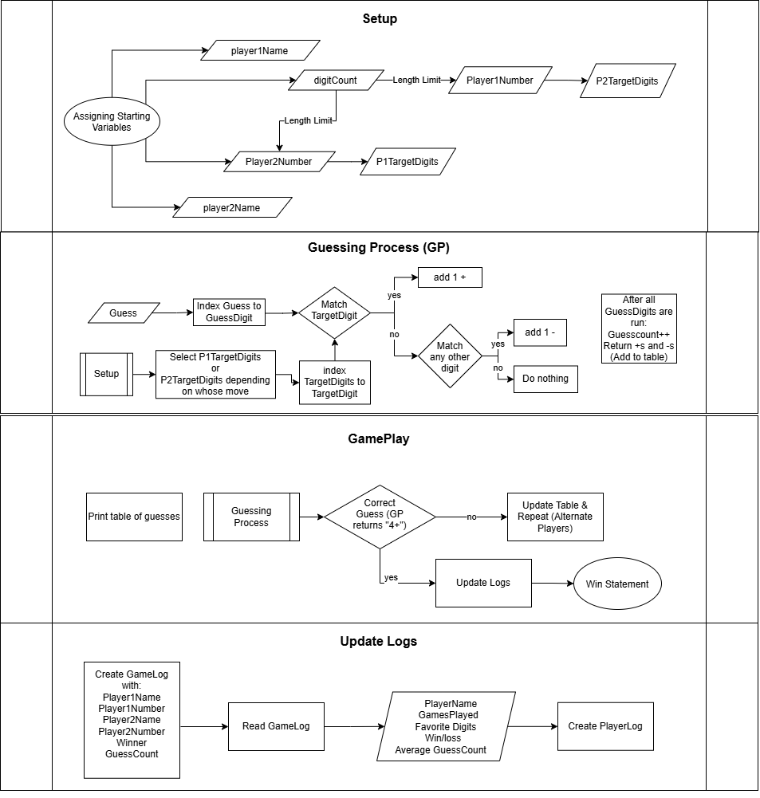

# Ahmet Abacus

This program is a 2-player number guessing game that stores game scores and player stats to logs

## The Problem

A couple years ago I had this friend and classmate who I would play this back-and-forth number guessing game with. Unfortunately, he moved away and we grew apart but recently we reunited and played the same game. I am trying to create a fun competitive brain game that can connect others the way it connected this friend and I.

## How It Works

A paragraph or a few bullets explaining what the software does at a
high level. If you have a diagram, embed it here:
The program
- Inputs names and numbers for each player
- Lets the two player's guess each other's numbers, returning + if a number is in the correct digit and a - when a number is in the target but not in the right digit
- Stores game logs with stats from each game in a file
- Stores player logs with stats for each player in a file



## Tech Stack

- **Language:** Java
- **Libraries:** N/A
- **External tools:** Logs stored as .csv files

## Setup

Step-by-step: how does someone who just cloned your repo get it
running?

```bash or any shell
git clone https://github.com/Ajbrinkmann/Ahmet-Abacus-CS193-Final-Project
cd Ahmet-Abacus-CS193-Final-Project
```

## Usage

How to actually run the thing, with examples.

Run the program by typing 'java newGame.java' in the terminal

## Roadmap

Features you haven't built yet but plan to (pull these from your
"Schedule" quadrant in the Eisenhower Matrix).

- [ ] Discord Implementation
- [ ] AI Opponent

## Author

Your name, a link to your GitHub.
Alden Brinkmann, [https://github.com/Ajbrinkmann](url)
